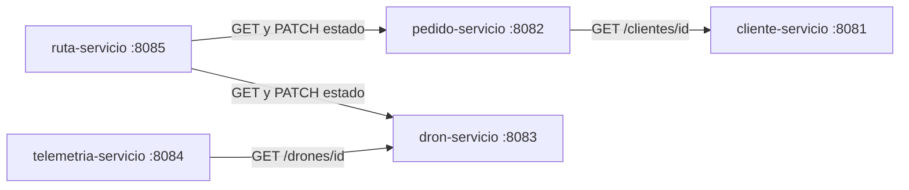

<div align="center">

# 🚁 FlotaDeDrones

**Sistema de entrega con drones basado en microservicios**


</div>

---

## 📖 Descripción

Este proyecto es el back end de un sistema de gestión de entregas mediante drones, desarrollado como **trabajo académico**. Los clientes realizan pedidos que el sistema asigna a drones disponibles, validando el peso del pedido contra la capacidad máxima del dron y su nivel de batería. Cada dron reporta su telemetría (ubicación y batería) durante el vuelo, y cada asignación genera una ruta asociada al pedido.

El sistema está dividido en **5 microservicios**. Cada uno es un proyecto Spring Boot independiente y tiene su propia base de datos.

> Alcance: solo back end (API REST). Las pruebas se realizan con Postman.

## 🎓 Datos académicos

| | |
|---|---|
| **Universidad** | Universidad del Norte Santo Tomás de Aquino (UNSTA) |
| **Asignatura** | BackEnd |
| **Profesor** | Tulio Martín Ruesjas |

## 👥 Integrantes

| Nombre | Módulos a cargo |
|--------|-----------------|
| Arevalo Santiago | `cliente-servicio`, `pedido-servicio` y `ruta-servicio` |
| Cejas Tomás | `dron-servicio` y `telemetria-servicio` |

## 🛠️ Tecnologías

| Tecnología | Uso |
|------------|-----|
| Java 25 | Lenguaje principal |
| Spring Boot 4.1.2 | Framework de cada microservicio |
| Spring Web | API REST y cliente HTTP (`RestClient`) para la comunicación entre servicios |
| Spring Data JPA (Hibernate) | Acceso a datos y mapeo de entidades |
| PostgreSQL en Neon | Una base de datos por microservicio, alojadas en la nube |
| Lombok | Generación de getters, setters y constructores |
| Maven | Gestión de dependencias y build |
| Postman | Pruebas de los endpoints |
| pgAdmin | Consulta y verificación de las bases de datos |
| IntelliJ IDEA | Entorno de desarrollo |
| Git y GitHub | Control de versiones y trabajo en equipo |

## 🏗️ Arquitectura de microservicios

| Microservicio | Entidades | Puerto | Base de datos | Paquete base |
|---------------|-----------|:------:|---------------|--------------|
| `cliente-servicio` | `Cliente` | 8081 | `cliente_db` | `com.example.cliente` |
| `pedido-servicio` | `Pedido`, enum `EstadoPedido` | 8082 | `pedido_db` | `com.example.pedido` |
| `dron-servicio` | `Dron`, enum `EstadoDron` | 8083 | `dron_db` | `com.example.dron` |
| `telemetria-servicio` | `Telemetria` | 8084 | `telemetria_db` | `com.example.telemetria` |
| `ruta-servicio` | `Ruta` | 8085 | `ruta_db` | `com.example.ruta` |

Cada servicio tiene su propia base de datos y **ningún servicio accede a la base de otro**. Cuando necesita un dato ajeno, lo pide por HTTP al servicio dueño de ese dato.

### Comunicación entre servicios



| Servicio que llama | Servicio llamado | Para qué |
|--------------------|------------------|----------|
| `pedido-servicio` | `cliente-servicio` | Comprobar que el cliente exista antes de crear un pedido |
| `ruta-servicio` | `pedido-servicio` | Consultar el pedido y pasarlo a `EN_CAMINO` |
| `ruta-servicio` | `dron-servicio` | Consultar el dron y pasarlo a `EN_VUELO` |
| `telemetria-servicio` | `dron-servicio` | Comprobar que el dron exista antes de guardar telemetría |

## 🧩 Diagrama UML


El UML es el modelo de dominio original. Al separar el sistema en microservicios, las relaciones entre entidades de servicios distintos dejaron de ser claves foráneas y pasaron a ser **referencias por id**, porque cada servicio tiene su propia base de datos.

| Relación del UML | Cómo se resuelve ahora |
|------------------|------------------------|
| Pedido → Cliente | `pedido.id_cliente` (referencia por id; se valida contra `cliente-servicio`) |
| Telemetría → Dron | `telemetria.id_dron` (referencia por id; se valida contra `dron-servicio`) |
| Ruta → Dron | `ruta.id_dron` (referencia por id; se valida contra `dron-servicio`) |
| Ruta → Pedido | `ruta.id_pedido` (referencia por id; se valida contra `pedido-servicio`) |

### Entidades por servicio

**`Cliente`** (`cliente-servicio`)

| Atributo | Tipo | Notas |
|----------|------|-------|
| `idCliente` | `Integer` | Clave primaria autogenerada |
| `nombre` | `String` | |
| `email` | `String` | |
| `direccion` | `String` | |

**`Pedido`** (`pedido-servicio`)

| Atributo | Tipo | Notas |
|----------|------|-------|
| `idPedido` | `Integer` | Clave primaria autogenerada |
| `origen` | `String` | |
| `destino` | `String` | |
| `peso` | `double` | |
| `estado` | `EstadoPedido` | Enum guardado como texto |
| `fechaCreacion` | `LocalDateTime` | Se asigna al crear |
| `idCliente` | `Integer` | Referencia al cliente |

**`Dron`** (`dron-servicio`)

| Atributo | Tipo | Notas |
|----------|------|-------|
| `idDron` | `Integer` | Clave primaria autogenerada |
| `modelo` | `String` | Obligatorio |
| `capacidadMaxima` | `double` | |
| `bateria` | `int` | |
| `estado` | `EstadoDron` | Enum guardado como texto, obligatorio |

**`Telemetria`** (`telemetria-servicio`)

| Atributo | Tipo | Notas |
|----------|------|-------|
| `idTelemetria` | `Integer` | Clave primaria autogenerada |
| `latitud` | `double` | |
| `longitud` | `double` | |
| `bateria` | `int` | |
| `fechaRegistro` | `LocalDateTime` | Obligatorio |
| `idDron` | `Integer` | Referencia al dron, obligatorio |

**`Ruta`** (`ruta-servicio`)

| Atributo | Tipo | Notas |
|----------|------|-------|
| `idRuta` | `Integer` | Clave primaria autogenerada |
| `puntosRecorrido` | `String` | Columna `TEXT`, sin límite de 255 caracteres |
| `distanciaKm` | `double` | |
| `fechaAsignacion` | `LocalDateTime` | Se asigna al crear |
| `idDron` | `Integer` | Referencia al dron |
| `idPedido` | `Integer` | Referencia al pedido |

### Enums

| Enum | Valores |
|------|---------|
| `EstadoPedido` | `PENDIENTE`, `EN_CAMINO`, `ENTREGADO`, `CANCELADO` |
| `EstadoDron` | `DISPONIBLE`, `EN_VUELO`, `MANTENIMIENTO` |

## 📁 Estructura del repositorio

```
FlotaDeDrones/
├── cliente-servicio/        # Proyecto Spring Boot (puerto 8081)
├── pedido-servicio/         # Proyecto Spring Boot (puerto 8082)
├── dron-servicio/           # Proyecto Spring Boot (puerto 8083)
├── telemetria-servicio/     # Proyecto Spring Boot (puerto 8084)
├── ruta-servicio/           # Proyecto Spring Boot (puerto 8085)
├── Recursos Desechados/     # Proyecto monolítico anterior (solo para consulta)
├── docs/                    # Diagramas del informe
└── README.md
```

Cada microservicio sigue la misma estructura interna:

```
<servicio>/src/main/java/com/example/<nombre>/
├── controller/    # Endpoints REST
├── service/       # Lógica de negocio
├── repository/    # Interfaces JpaRepository
├── model/         # Entidades JPA y enums
├── dto/           # Objetos de transferencia (solo ruta-servicio)
└── <Nombre>ServicioApplication.java
```

## ⚙️ Cómo ejecutar el proyecto

### Requisitos previos

- JDK 25
- Maven (o el wrapper `mvnw` incluido en cada proyecto)
- Las credenciales de Neon (se piden a los integrantes por privado, no están en el repositorio)
- Las cinco bases de datos creadas en Neon: `cliente_db`, `pedido_db`, `dron_db`, `telemetria_db` y `ruta_db`

### Pasos

**1. Clonar el repositorio**

```bash
git clone https://github.com/TomIcj/FlotaDeDrones.git
cd FlotaDeDrones
```

**2. Crear el `application.properties` de cada servicio**

Cada servicio necesita su propio `src/main/resources/application.properties`. Estos archivos están excluidos del repositorio (`.gitignore`) porque contienen la contraseña, y Git tampoco guarda carpetas vacías, por lo que también hay que crear la carpeta `resources` si no existe.

Ejemplo para `cliente-servicio`:

```properties
spring.application.name=cliente-servicio
server.port=8081

spring.datasource.url=jdbc:postgresql://HOST_DE_NEON:5432/cliente_db?sslmode=require
spring.datasource.username=USUARIO
spring.datasource.password=TU_CONTRASEÑA

spring.jpa.hibernate.ddl-auto=update
spring.jpa.show-sql=true
```

Para los demás servicios solo cambian el nombre, el puerto y la base de datos:

| Servicio | `spring.application.name` | `server.port` | Base en la URL |
|----------|---------------------------|:-------------:|----------------|
| `cliente-servicio` | `cliente-servicio` | 8081 | `cliente_db` |
| `pedido-servicio` | `pedido-servicio` | 8082 | `pedido_db` |
| `dron-servicio` | `dron-servicio` | 8083 | `dron_db` |
| `telemetria-servicio` | `telemetria-servicio` | 8084 | `telemetria_db` |
| `ruta-servicio` | `ruta-servicio` | 8085 | `ruta_db` |

> Neon exige conexión segura, por eso la URL termina en `?sslmode=require`. Con `ddl-auto=update`, Hibernate crea las tablas a partir de las entidades al iniciar cada servicio.

**3. Ejecutar los servicios**

Cada servicio se ejecuta por separado (desde su carpeta, con `mvn spring-boot:run`, o desde IntelliJ con su clase `...Application`). Para probar el flujo completo tienen que estar levantados **a la vez**. La primera conexión puede tardar unos segundos si Neon estaba suspendida.

### Abrir los proyectos en IntelliJ

Cada microservicio es un proyecto Maven distinto. Hay que abrir el `pom.xml` de cada carpeta (*File → Open → pom.xml → Open as Project*), una ventana por servicio. Si se abre la carpeta raíz del repositorio, IntelliJ no reconoce el código.

## 📡 Endpoints

Cada servicio se consulta directamente en su puerto (no hay API Gateway).

| Servicio | Método | Ruta | Descripción | Implementado |
|----------|--------|------|-------------|:------------:|
| cliente (8081) | `POST` | `/clientes` | Registrar un cliente | ✅ |
| cliente (8081) | `GET` | `/clientes` | Listar clientes | ✅ |
| cliente (8081) | `GET` | `/clientes/{id}` | Buscar un cliente | ✅ |
| pedido (8082) | `POST` | `/pedidos` | Crear un pedido (valida el cliente, estado inicial `PENDIENTE`) | ✅ |
| pedido (8082) | `GET` | `/pedidos` | Listar pedidos | ✅ |
| pedido (8082) | `GET` | `/pedidos/{id}` | Buscar un pedido | ✅ |
| pedido (8082) | `PATCH` | `/pedidos/{id}/estado?estado=` | Cambiar el estado de un pedido | ✅ |
| dron (8083) | `POST` | `/drones` | Registrar un dron | ✅ |
| dron (8083) | `GET` | `/drones` | Listar drones | ✅ |
| dron (8083) | `GET` | `/drones/{id}` | Buscar un dron | ✅ |
| dron (8083) | `PUT` | `/drones/{id}` | Actualizar un dron | ✅ |
| dron (8083) | `PATCH` | `/drones/{id}/estado?estado=` | Cambiar el estado de un dron | ✅ |
| dron (8083) | `DELETE` | `/drones/{id}` | Eliminar un dron | ✅ |
| telemetria (8084) | `POST` | `/telemetrias` | Registrar la telemetría de un dron (valida el dron) | ✅ |
| telemetria (8084) | `GET` | `/telemetrias` | Listar toda la telemetría | ✅ |
| telemetria (8084) | `GET` | `/telemetrias/{id}` | Buscar un registro de telemetría | ✅ |
| telemetria (8084) | `GET` | `/telemetrias/dron/{idDron}` | Listar la telemetría de un dron | ✅ |
| telemetria (8084) | `DELETE` | `/telemetrias/{id}` | Eliminar un registro de telemetría | ✅ |
| ruta (8085) | `POST` | `/rutas` | Crear una ruta manualmente | ✅ |
| ruta (8085) | `POST` | `/rutas/asignar` | Asignar un dron a un pedido y generar la ruta | ✅ |
| ruta (8085) | `GET` | `/rutas` | Listar rutas | ✅ |
| ruta (8085) | `GET` | `/rutas/{id}` | Buscar una ruta | ✅ |

> ✅ implementado. El flujo principal está probado en Postman (ver la sección *Pruebas en Postman*).

## 🧠 Reglas de negocio

- Un pedido se crea en estado `PENDIENTE`, con la fecha de creación asignada por el servidor.
- Para crear un pedido, el cliente debe existir en `cliente-servicio` (si no, responde **404**; si el servicio no responde, **503**).
- Para registrar telemetría, el dron debe existir en `dron-servicio`.
- Para asignar, el pedido debe estar `PENDIENTE` y el dron `DISPONIBLE` (si no, **409**).
- El peso del pedido no puede superar la `capacidadMaxima` del dron (si no, **409**).
- El dron debe tener al menos un 30 % de batería para ser asignado (si no, **409**).
- Al asignar, se guarda la ruta, el pedido pasa a `EN_CAMINO` y el dron a `EN_VUELO`.

### Flujo de la asignación (`POST /rutas/asignar`)

1. `ruta-servicio` consulta el pedido a `pedido-servicio` y el dron a `dron-servicio`.
2. Valida las reglas de negocio anteriores.
3. Guarda la ruta en `ruta_db` con `idPedido` e `idDron`.
4. Pide a `pedido-servicio` que cambie el pedido a `EN_CAMINO`.
5. Pide a `dron-servicio` que cambie el dron a `EN_VUELO`.

### Códigos de respuesta utilizados

| Código | Cuándo |
|:------:|--------|
| `200` | Consulta o modificación correcta |
| `201` | Recurso creado |
| `204` | Recurso eliminado (sin cuerpo en la respuesta) |
| `400` | Faltan datos obligatorios (por ejemplo `idCliente`) o el valor del estado no es válido |
| `404` | El recurso no existe |
| `409` | La operación choca con el estado actual de los datos (pedido no pendiente, dron no disponible, sin batería o sin capacidad) |
| `503` | Otro microservicio no está disponible |

## 🧪 Pruebas en Postman

Todas las pruebas se hicieron con los servicios levantados en local. Cada cuerpo se envía en *Body → raw → JSON*.

### Flujo principal (cliente → pedido → dron → asignación)

Con `cliente-servicio`, `pedido-servicio`, `dron-servicio` y `ruta-servicio` levantados:

| Paso | Solicitud | Resultado |
|:----:|-----------|-----------|
| 1 | `POST http://localhost:8081/clientes` | `201`, devuelve `idCliente` |
| 2 | `POST http://localhost:8083/drones` | `201`, devuelve `idDron` |
| 3 | `POST http://localhost:8082/pedidos` (con ese `idCliente`) | `201`, estado `PENDIENTE` |
| 4 | `POST http://localhost:8085/rutas/asignar` | `201`, devuelve la ruta |
| 5 | `GET http://localhost:8082/pedidos/{id}` | Estado `EN_CAMINO` |
| 6 | `GET http://localhost:8083/drones/{id}` | Estado `EN_VUELO` |

Ejemplo de cuerpo de la asignación:

```json
{
  "idPedido": 1,
  "idDron": 1,
  "puntosRecorrido": "[[-26.83,-65.20],[-26.84,-65.21]]",
  "distanciaKm": 3.5
}
```

### Telemetría

Con `telemetria-servicio` levantado:

| Solicitud | Resultado |
|-----------|-----------|
| `POST http://localhost:8084/telemetrias` | `201`, devuelve el registro con su `idTelemetria` |
| `GET http://localhost:8084/telemetrias` | `200`, lista de registros |
| `GET http://localhost:8084/telemetrias/{id}` | `200`, el registro buscado |
| `GET http://localhost:8084/telemetrias/dron/{idDron}` | `200`, registros de ese dron |
| `DELETE http://localhost:8084/telemetrias/{id}` | `204`, sin cuerpo |

Ejemplo de cuerpo:

```json
{
  "latitud": -26.83,
  "longitud": -65.20,
  "bateria": 78,
  "fechaRegistro": "2026-11-06T19:55:00",
  "idDron": 1
}
```

### Pruebas de error

| Caso | Resultado esperado |
|------|--------------------|
| Repetir la asignación del mismo pedido | `409`, el pedido no está pendiente |
| Crear un pedido con un cliente inexistente | `404`, cliente no encontrado |
| Asignar con `dron-servicio` apagado | `503`, servicio no disponible |

## 📓 Bitácora de avance

### Avance 1 — 25/10/2026

**Objetivo:** dejar listo el entorno de trabajo, la conexión a la base de datos y el modelo de datos completo (entidades JPA) a partir del diagrama UML.

> En esta etapa el proyecto era una única aplicación (monolito). Luego se reestructuró en microservicios (Avance 2).

#### Qué hicimos

**Entorno y configuración (ambos)**

- Creamos el repositorio en GitHub y el proyecto base con Spring Boot 4.1.2, Maven y Java 25.
- Dependencias del proyecto: Spring Web, Spring Data JPA, PostgreSQL Driver, Validation y Lombok.
- Conectamos la aplicación a una base PostgreSQL alojada en **Neon**.
- Configuramos `application.properties` (URL con SSL, usuario, contraseña) y habilitamos `ddl-auto=update` para que Hibernate cree las tablas a partir de las entidades.
- Protegimos las credenciales: `application.properties` está en el `.gitignore`.
- Configuramos Lombok en el `pom.xml` (dependencia y procesador de anotaciones).
- Armamos el README con la descripción, el UML, las instrucciones de ejecución y esta bitácora.

**Modelo de datos (por integrante)**

| Integrante | Trabajo realizado |
|------------|-------------------|
| Arevalo Santiago | Entidades `Cliente` y `Pedido`, enum `EstadoPedido`. Relación `Pedido` → `Cliente` con `@ManyToOne` y `@JoinColumn`. |
| Cejas Tomás | Entidades `Dron`, `Telemetria` y `Ruta`, enum `EstadoDron`. Relaciones `Telemetria` → `Dron`, `Ruta` → `Dron` y `Ruta` → `Pedido`. |

**Decisiones técnicas**

- Los estados son **enums** con `@Enumerated(EnumType.STRING)` en lugar de `String`: evita valores inválidos y deja legibles los datos en la base.
- Los ids son `Integer` con `GenerationType.IDENTITY`, para que sean `null` antes de guardar y los genere la base.
- `puntosRecorrido` usa `columnDefinition = "TEXT"` porque un `String` común admite solo 255 caracteres.
- Se usa Lombok (`@Getter`, `@Setter`, `@NoArgsConstructor`) para reducir el código repetitivo.

#### Resultado

Hibernate creó en Neon las cinco tablas del modelo (`cliente`, `pedido`, `dron`, `ruta` y `telemetria`), con sus claves foráneas, verificadas desde pgAdmin.

#### Problemas y soluciones

| Problema | Causa | Solución |
|----------|-------|----------|
| Riesgo de subir la contraseña a GitHub | La línea de `application.properties` se había escrito por error en `.gitattributes`, donde no tiene efecto | La movimos al `.gitignore` y comprobamos con `git status` que el archivo no se rastrea |
| Lombok no generaba getters ni setters con JDK 25 | Desde el JDK 23, Java ya no ejecuta automáticamente los procesadores de anotaciones | Declaramos `annotationProcessorPaths` de Lombok en el `maven-compiler-plugin` y activamos *Annotation Processing* en IntelliJ |
| Clase duplicada al crear una entidad | IntelliJ ya genera el `package` y la clase; al pegar el código quedaron repetidos | Seleccionar todo el contenido (`Ctrl + A`) y pegar encima |
| Enum con el contenido equivocado | Se pegó `EstadoDron` dentro de `EstadoPedido` | Dejar en cada archivo solo su enum |
| IntelliJ no reconocía el código ni permitía ejecutar (Tomás) | Se abrió la carpeta raíz del repositorio, no la carpeta con el `pom.xml` | Agregar el `pom.xml` con *Add as Maven Project* y configurar el SDK 25 |
| Error de Maven `Unable to create injector ... MissingImplementation` (Tomás) | IntelliJ usaba una versión de Maven que no correspondía | Configurar el *Maven home path* para usar el wrapper del proyecto o el Maven incluido en IntelliJ |

### Avance 2 — 02/11/2026 al 04/11/2026

**Objetivo:** reestructurar el sistema en 5 microservicios, cada uno con su proyecto Spring Boot y su base de datos, y lograr que se comuniquen entre sí.

#### Qué hicimos

**Cambio de arquitectura (ambos)**

- El profesor pidió dividir el sistema en **5 microservicios**, cada uno con su propia base de datos y su propio proyecto Spring Boot.
- Como la migración desde el monolito se volvió difícil de seguir, decidimos **empezar de cero** con la nueva arquitectura. El proyecto anterior se movió a `Recursos Desechados` para copiar de ahí el código que hiciera falta.
- Generamos cinco proyectos en start.spring.io con las mismas dependencias (Spring Web, Spring Data JPA, PostgreSQL Driver, Validation y Lombok), Java 25 y Spring Boot 4.1.2.
- Creamos en Neon las cinco bases de datos (`cliente_db`, `pedido_db`, `dron_db`, `telemetria_db` y `ruta_db`) y asignamos un puerto a cada servicio (8081 a 8085).

**Trabajo por integrante**

| Integrante | Trabajo realizado |
|------------|-------------------|
| Arevalo Santiago | `cliente-servicio` y `pedido-servicio` completos (entidad, repositorio, servicio y controller). `ruta-servicio` con la asignación de dron a pedido. Validación del cliente en `pedido-servicio` y endpoint para cambiar el estado del pedido. Endpoint para cambiar el estado del dron en `dron-servicio`. |
| Cejas Tomás | Creación de las bases de datos en Neon. `dron-servicio` y `telemetria-servicio` (entidades, repositorios, servicios y controllers). |

**Comunicación entre servicios**

- `pedido-servicio` comprueba con `cliente-servicio` que el cliente exista antes de guardar un pedido.
- `ruta-servicio` consulta el pedido y el dron, valida las reglas de negocio, guarda la ruta y pide a los otros dos servicios que cambien los estados (`EN_CAMINO` y `EN_VUELO`).
- La comunicación se hace con `RestClient` de Spring, sin dependencias adicionales.

**Decisiones técnicas**

- Las relaciones entre servicios son **referencias por id** (`idCliente`, `idDron`, `idPedido`) y no `@ManyToOne`, porque cada servicio tiene su propia base de datos y no puede haber claves foráneas entre bases.
- Cada servicio es dueño de sus datos: para cambiar un estado de otro servicio, se le pide por HTTP con un `PATCH`.
- Se usan **DTO como `record`** en `ruta-servicio` (`PedidoDto`, `DronDto` y `AsignacionRequest`) para recibir las respuestas de otros servicios sin copiar sus entidades.
- Los errores se devuelven con `ResponseStatusException` y códigos HTTP claros (400, 404, 409 y 503).
- No se usa API Gateway: cada servicio se consulta directamente en su puerto.

#### Problemas y soluciones

| Problema | Causa | Solución |
|----------|-------|----------|
| start.spring.io rechazaba el nombre del paquete | El *Package name* se autocompleta con el guion del artifact (`cliente-servicio`) y un paquete Java no admite guiones | Escribir el artifact con guion y corregir a mano el paquete (`com.example.cliente`) |
| `application.properties` aparecía en la lista de commit | En un commit anterior Git ya había guardado una versión del archivo, y una regla del `.gitignore` no afecta archivos que Git ya rastrea | `git rm --cached src/main/resources/application.properties` y commit de la baja. Comprobamos en GitHub que la contraseña no se subió |
| La carpeta `.idea` quedaba en la lista de commit | Configuración personal de IntelliJ sin ignorar | Dejar de rastrearla y agregar `.idea/` al `.gitignore` de la raíz |
| `Failed to configure a DataSource: 'url' attribute is not specified` al abrir `dron-servicio` | El `application.properties` está ignorado por Git, y Git tampoco guarda carpetas vacías, por lo que la carpeta `resources` no existía al clonar | Crear la carpeta `resources` y el archivo `application.properties` en cada equipo |
| El nuevo método del controller no compilaba | Se pegó dentro del cuerpo de otro método, después de un `return` | Cerrar la llave del método anterior y dejar el nuevo método al mismo nivel |
| Aviso `open-in-view` al arrancar | Valor por defecto de Spring Boot | Es solo un aviso; no afecta el funcionamiento |

#### Resultado

Los cinco servicios existen, cada uno con su base de datos en Neon, y arrancan por separado en su puerto.

#### Qué sigue

Probar el flujo completo en Postman y validar el dron en `telemetria-servicio` (ver Avance 3).

### Avance 3 — 06/11/2026

**Objetivo:** probar en Postman todo el sistema funcionando en conjunto y completar la validación del dron en telemetría.

#### Qué hicimos

| Integrante | Trabajo realizado |
|------------|-------------------|
| Arevalo Santiago | Pruebas del flujo completo en Postman: crear cliente, dron y pedido, y asignar el dron al pedido. Verificación de que los estados cambian en los otros servicios (`EN_CAMINO` y `EN_VUELO`). Pruebas de error (`409`, `404` y `503`). |
| Cejas Tomás | Validación de que el dron exista antes de registrar telemetría en `telemetria-servicio`. Pruebas de los endpoints de telemetría: registrar, listar, buscar, listar por dron y eliminar. |

- Se comprobó que los servicios se comunican correctamente: `pedido-servicio` valida al cliente en `cliente-servicio`, y `ruta-servicio` consulta y modifica el pedido y el dron.
- Se actualizó el README con los endpoints reales de cada servicio y los resultados de las pruebas.

#### Problemas y soluciones

| Problema | Causa | Solución |
|----------|-------|----------|
| `404` al registrar un cliente en Postman | La solicitud iba a `/cliente` (singular) y el controller está mapeado a `/clientes` | Usar las rutas tal como están definidas en cada `@RequestMapping` (`/clientes`, `/pedidos`, `/drones`, `/telemetrias`, `/rutas`) |
| La solicitud llegaba sin cuerpo | El JSON se había escrito en la pestaña *Pre-request Script* de Postman | Dejar vacío el script y poner el JSON en *Body → raw → JSON* |
| La primera solicitud tardaba varios segundos | La base en Neon se suspende cuando no se usa y tarda en despertar | Es esperable; las solicitudes siguientes responden rápido |

#### Resultado

Los cinco microservicios funcionan y se comunican entre sí. El flujo completo (cliente → pedido → dron → asignación → estados) y los endpoints de telemetría responden con los códigos esperados.

#### Qué sigue

Lo último que falta es el **despliegue** del sistema (ver la sección *Despliegue*).

<!-- Copien este bloque para cada nuevo avance -->

## 🚀 Despliegue

**Estado: pendiente. Es lo último que falta del proyecto.**

El profesor pidió que el sistema esté desplegado en un servidor gratuito. Como es un back end sin frontend, desplegarlo significa dejar cada servicio disponible en una URL pública, para consumirlo desde Postman sin depender de una computadora local. Las bases de datos ya están en Neon, así que no hay que migrarlas.

Plan previsto:

- Un servicio web por cada microservicio (cinco en total), todos conectados a este mismo repositorio, cada uno apuntando a su carpeta.
- Un `Dockerfile` por servicio para compilarlo y ejecutarlo.
- La configuración (URL de la base, usuario y contraseña) como variables de entorno de la plataforma, en lugar del `application.properties`, que no está en el repositorio.
- Reemplazar las direcciones `localhost` que usan `pedido-servicio` y `ruta-servicio` para llamar a otros servicios por las URLs públicas de cada uno, definidas como configuración.
- El puerto de cada servicio tomado desde la plataforma.

## ✅ Estado del proyecto

- [x] Repositorio y proyecto base
- [x] Conexión a PostgreSQL (Neon)
- [x] Modelo de datos y entidades
- [x] División en 5 microservicios con su base de datos
- [x] `cliente-servicio`
- [x] `pedido-servicio`
- [x] `dron-servicio`
- [x] `telemetria-servicio` (endpoints y validación del dron)
- [x] `ruta-servicio` (asignación de dron a pedido)
- [x] Comunicación entre servicios
- [x] Pruebas en Postman
- [ ] **Despliegue** (último paso pendiente)
