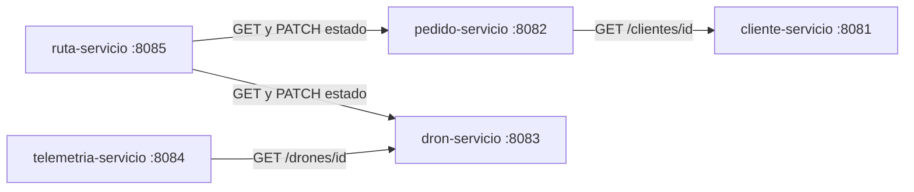

<div align="center">

# 🚁 FlotaDeDrones

**Sistema de entrega con drones basado en microservicios**


</div>

---

## 📖 Descripción

Este proyecto es el back end de un sistema de gestión de entregas mediante drones, desarrollado como **trabajo académico**. Los clientes realizan pedidos que el sistema asigna a drones disponibles, validando el peso del pedido contra la capacidad máxima del dron y su nivel de batería. Cada dron reporta su telemetría (ubicación y batería) durante el vuelo, y cada asignación genera una ruta asociada al pedido.

El sistema está dividido en **5 microservicios**. Cada uno es un proyecto Spring Boot independiente y tiene su propia base de datos.

> Alcance: solo back end (API REST). Las pruebas se realizan con Postman.

## 🎓 Datos académicos

| | |
|---|---|
| **Universidad** | Universidad del Norte Santo Tomás de Aquino (UNSTA) |
| **Asignatura** | BackEnd |
| **Profesor** | Tulio Martín Ruesjas |

## 👥 Integrantes

| Nombre | Módulos a cargo |
|--------|-----------------|
| Arevalo Santiago | `cliente-servicio`, `pedido-servicio` y `ruta-servicio` |
| Cejas Tomás | `dron-servicio` y `telemetria-servicio` |

## 🛠️ Tecnologías

| Tecnología | Uso |
|------------|-----|
| Java 25 | Lenguaje principal |
| Spring Boot 4.1.2 | Framework de cada microservicio |
| Spring Web | API REST y cliente HTTP (`RestClient`) para la comunicación entre servicios |
| Spring Data JPA (Hibernate) | Acceso a datos y mapeo de entidades |
| PostgreSQL en Neon | Una base de datos por microservicio, alojadas en la nube |
| Lombok | Generación de getters, setters y constructores |
| Maven | Gestión de dependencias y build |
| Postman | Pruebas de los endpoints |
| pgAdmin | Consulta y verificación de las bases de datos |
| IntelliJ IDEA | Entorno de desarrollo |
| Git y GitHub | Control de versiones y trabajo en equipo |

## 🏗️ Arquitectura de microservicios

| Microservicio | Entidades | Puerto | Base de datos | Paquete base |
|---------------|-----------|:------:|---------------|--------------|
| `cliente-servicio` | `Cliente` | 8081 | `cliente_db` | `com.example.cliente` |
| `pedido-servicio` | `Pedido`, enum `EstadoPedido` | 8082 | `pedido_db` | `com.example.pedido` |
| `dron-servicio` | `Dron`, enum `EstadoDron` | 8083 | `dron_db` | `com.example.dron` |
| `telemetria-servicio` | `Telemetria` | 8084 | `telemetria_db` | `com.example.telemetria` |
| `ruta-servicio` | `Ruta` | 8085 | `ruta_db` | `com.example.ruta` |

Cada servicio tiene su propia base de datos y **ningún servicio accede a la base de otro**. Cuando necesita un dato ajeno, lo pide por HTTP al servicio dueño de ese dato.

### Comunicación entre servicios



| Servicio que llama | Servicio llamado | Para qué |
|--------------------|------------------|----------|
| `pedido-servicio` | `cliente-servicio` | Comprobar que el cliente exista antes de crear un pedido |
| `ruta-servicio` | `pedido-servicio` | Consultar el pedido y pasarlo a `EN_CAMINO` |
| `ruta-servicio` | `dron-servicio` | Consultar el dron y pasarlo a `EN_VUELO` |
| `telemetria-servicio` | `dron-servicio` | Comprobar que el dron exista antes de guardar telemetría |

## 🧩 Diagrama UML


El UML es el modelo de dominio original. Al separar el sistema en microservicios, las relaciones entre entidades de servicios distintos dejaron de ser claves foráneas y pasaron a ser **referencias por id**, porque cada servicio tiene su propia base de datos.

| Relación del UML | Cómo se resuelve ahora |
|------------------|------------------------|
| Pedido → Cliente | `pedido.id_cliente` (referencia por id; se valida contra `cliente-servicio`) |
| Telemetría → Dron | `telemetria.id_dron` (referencia por id; se valida contra `dron-servicio`) |
| Ruta → Dron | `ruta.id_dron` (referencia por id; se valida contra `dron-servicio`) |
| Ruta → Pedido | `ruta.id_pedido` (referencia por id; se valida contra `pedido-servicio`) |

### Entidades por servicio

**`Cliente`** (`cliente-servicio`)

| Atributo | Tipo | Notas |
|----------|------|-------|
| `idCliente` | `Integer` | Clave primaria autogenerada |
| `nombre` | `String` | |
| `email` | `String` | |
| `direccion` | `String` | |

**`Pedido`** (`pedido-servicio`)

| Atributo | Tipo | Notas |
|----------|------|-------|
| `idPedido` | `Integer` | Clave primaria autogenerada |
| `origen` | `String` | |
| `destino` | `String` | |
| `peso` | `double` | |
| `estado` | `EstadoPedido` | Enum guardado como texto |
| `fechaCreacion` | `LocalDateTime` | Se asigna al crear |
| `idCliente` | `Integer` | Referencia al cliente |

**`Dron`** (`dron-servicio`)

| Atributo | Tipo | Notas |
|----------|------|-------|
| `idDron` | `Integer` | Clave primaria autogenerada |
| `modelo` | `String` | Obligatorio |
| `capacidadMaxima` | `double` | |
| `bateria` | `int` | |
| `estado` | `EstadoDron` | Enum guardado como texto, obligatorio |

**`Telemetria`** (`telemetria-servicio`)

| Atributo | Tipo | Notas |
|----------|------|-------|
| `idTelemetria` | `Integer` | Clave primaria autogenerada |
| `latitud` | `double` | |
| `longitud` | `double` | |
| `bateria` | `int` | |
| `fechaRegistro` | `LocalDateTime` | Obligatorio |
| `idDron` | `Integer` | Referencia al dron, obligatorio |

**`Ruta`** (`ruta-servicio`)

| Atributo | Tipo | Notas |
|----------|------|-------|
| `idRuta` | `Integer` | Clave primaria autogenerada |
| `puntosRecorrido` | `String` | Columna `TEXT`, sin límite de 255 caracteres |
| `distanciaKm` | `double` | |
| `fechaAsignacion` | `LocalDateTime` | Se asigna al crear |
| `idDron` | `Integer` | Referencia al dron |
| `idPedido` | `Integer` | Referencia al pedido |

### Enums

| Enum | Valores |
|------|---------|
| `EstadoPedido` | `PENDIENTE`, `EN_CAMINO`, `ENTREGADO`, `CANCELADO` |
| `EstadoDron` | `DISPONIBLE`, `EN_VUELO`, `MANTENIMIENTO` |

## 📁 Estructura del repositorio

```
FlotaDeDrones/
├── cliente-servicio/        # Proyecto Spring Boot (puerto 8081)
├── pedido-servicio/         # Proyecto Spring Boot (puerto 8082)
├── dron-servicio/           # Proyecto Spring Boot (puerto 8083)
├── telemetria-servicio/     # Proyecto Spring Boot (puerto 8084)
├── ruta-servicio/           # Proyecto Spring Boot (puerto 8085)
├── Recursos Desechados/     # Proyecto monolítico anterior (solo para consulta)
├── docs/                    # Diagramas del informe
└── README.md
```

Cada microservicio sigue la misma estructura interna:

```
<servicio>/src/main/java/com/example/<nombre>/
├── controller/    # Endpoints REST
├── service/       # Lógica de negocio
├── repository/    # Interfaces JpaRepository
├── model/         # Entidades JPA y enums
├── dto/           # Objetos de transferencia (solo ruta-servicio)
└── <Nombre>ServicioApplication.java
```

## ⚙️ Cómo ejecutar el proyecto

### Requisitos previos

- JDK 25
- Maven (o el wrapper `mvnw` incluido en cada proyecto)
- Las credenciales de Neon (se piden a los integrantes por privado, no están en el repositorio)
- Las cinco bases de datos creadas en Neon: `cliente_db`, `pedido_db`, `dron_db`, `telemetria_db` y `ruta_db`

### Pasos

**1. Clonar el repositorio**

```bash
git clone https://github.com/TomIcj/FlotaDeDrones.git
cd FlotaDeDrones
```

**2. Crear el `application.properties` de cada servicio**

Cada servicio necesita su propio `src/main/resources/application.properties`. Estos archivos están excluidos del repositorio (`.gitignore`) porque contienen la contraseña, y Git tampoco guarda carpetas vacías, por lo que también hay que crear la carpeta `resources` si no existe.

Ejemplo para `cliente-servicio`:

```properties
spring.application.name=cliente-servicio
server.port=8081

spring.datasource.url=jdbc:postgresql://HOST_DE_NEON:5432/cliente_db?sslmode=require
spring.datasource.username=USUARIO
spring.datasource.password=TU_CONTRASEÑA

spring.jpa.hibernate.ddl-auto=update
spring.jpa.show-sql=true
```

Para los demás servicios solo cambian el nombre, el puerto y la base de datos:

| Servicio | `spring.application.name` | `server.port` | Base en la URL |
|----------|---------------------------|:-------------:|----------------|
| `cliente-servicio` | `cliente-servicio` | 8081 | `cliente_db` |
| `pedido-servicio` | `pedido-servicio` | 8082 | `pedido_db` |
| `dron-servicio` | `dron-servicio` | 8083 | `dron_db` |
| `telemetria-servicio` | `telemetria-servicio` | 8084 | `telemetria_db` |
| `ruta-servicio` | `ruta-servicio` | 8085 | `ruta_db` |

> Neon exige conexión segura, por eso la URL termina en `?sslmode=require`. Con `ddl-auto=update`, Hibernate crea las tablas a partir de las entidades al iniciar cada servicio.

**3. Ejecutar los servicios**

Cada servicio se ejecuta por separado (desde su carpeta, con `mvn spring-boot:run`, o desde IntelliJ con su clase `...Application`). Para probar el flujo completo tienen que estar levantados **a la vez**. La primera conexión puede tardar unos segundos si Neon estaba suspendida.

### Abrir los proyectos en IntelliJ

Cada microservicio es un proyecto Maven distinto. Hay que abrir el `pom.xml` de cada carpeta (*File → Open → pom.xml → Open as Project*), una ventana por servicio. Si se abre la carpeta raíz del repositorio, IntelliJ no reconoce el código.

## 📡 Endpoints

Cada servicio se consulta directamente en su puerto (no hay API Gateway).

| Servicio | Método | Ruta | Descripción | Implementado |
|----------|--------|------|-------------|:------------:|
| cliente (8081) | `POST` | `/clientes` | Registrar un cliente | ✅ |
| cliente (8081) | `GET` | `/clientes` | Listar clientes | ✅ |
| cliente (8081) | `GET` | `/clientes/{id}` | Buscar un cliente | ✅ |
| pedido (8082) | `POST` | `/pedidos` | Crear un pedido (valida el cliente, estado inicial `PENDIENTE`) | ✅ |
| pedido (8082) | `GET` | `/pedidos` | Listar pedidos | ✅ |
| pedido (8082) | `GET` | `/pedidos/{id}` | Buscar un pedido | ✅ |
| pedido (8082) | `PATCH` | `/pedidos/{id}/estado?estado=` | Cambiar el estado de un pedido | ✅ |
| dron (8083) | `POST` | `/drones` | Registrar un dron | ✅ |
| dron (8083) | `GET` | `/drones` | Listar drones | ✅ |
| dron (8083) | `GET` | `/drones/{id}` | Buscar un dron | ✅ |
| dron (8083) | `PUT` | `/drones/{id}` | Actualizar un dron | ✅ |
| dron (8083) | `PATCH` | `/drones/{id}/estado?estado=` | Cambiar el estado de un dron | ✅ |
| dron (8083) | `DELETE` | `/drones/{id}` | Eliminar un dron | ✅ |
| telemetria (8084) | `POST` | `/telemetrias` | Registrar la telemetría de un dron (valida el dron) | ✅ |
| telemetria (8084) | `GET` | `/telemetrias` | Listar toda la
